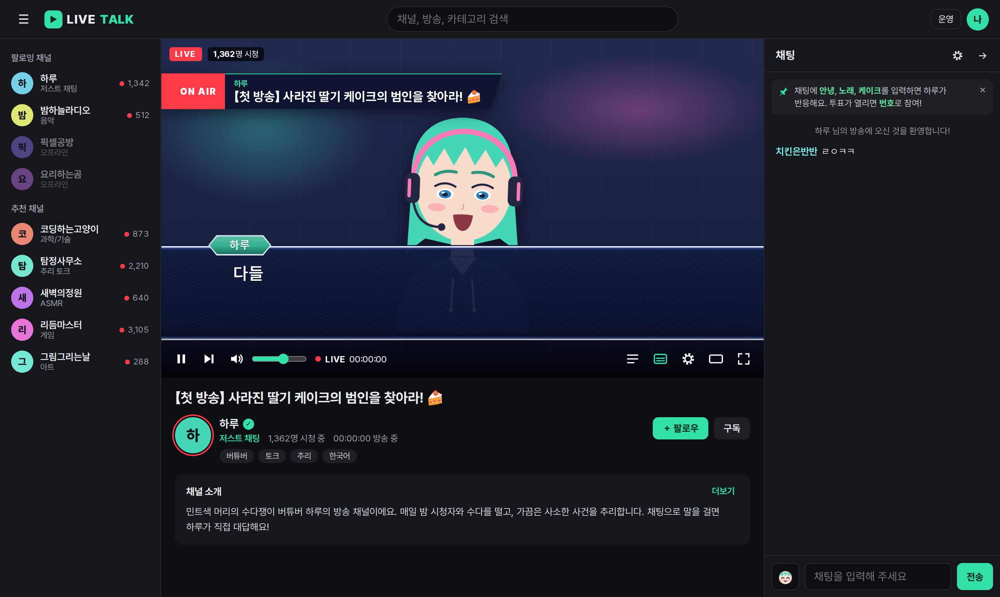
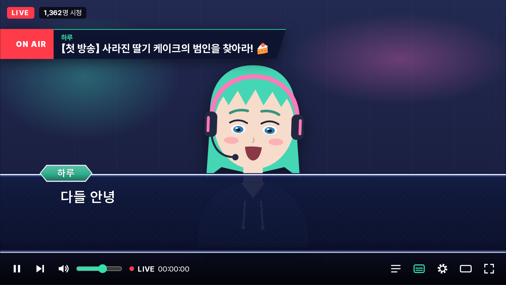
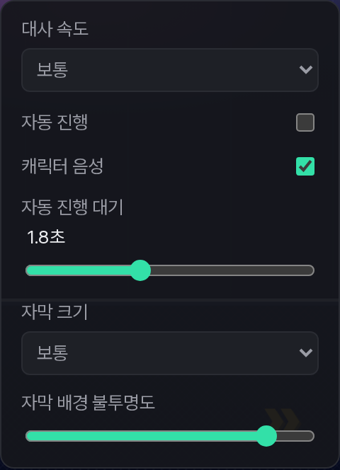
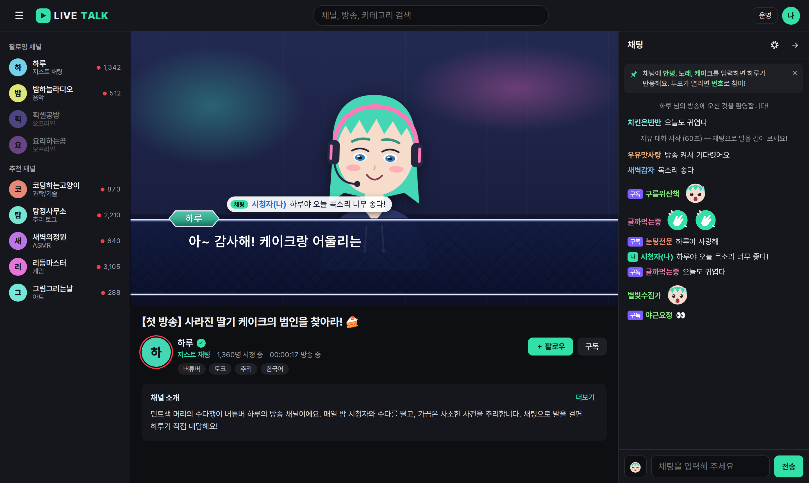
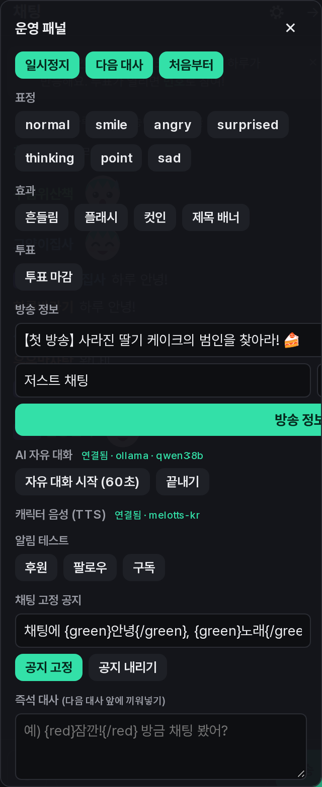
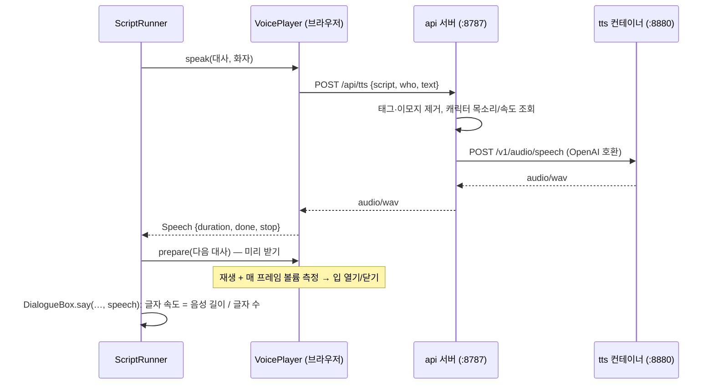

# 캐릭터 음성 (TTS) — SCR-07, CHR-05

> 작업 브랜치 `feat/tts` · 정리 2026-11-27

화자가 있는 대사를 캐릭터 목소리로 읽고, 음성 볼륨에 맞춰 입을 움직입니다.
TTS 는 로컬 Docker 컨테이너(MeloTTS 한국어, CPU)로 돌리므로 외부 API 키가 필요 없고, GPU 는 LLM 이 그대로 씁니다.

| 항목 | 요구사항 | 한 줄 요약 |
|---|---|---|
| 캐릭터 음성 | **SCR-07** | 대사를 음성으로 합성해 재생하고, 글자 출력 속도를 음성 길이에 맞춤 |
| 음성 립싱크 | **CHR-05** | Web Audio `AnalyserNode` 로 재생 중인 음성의 볼륨을 재서 입을 열고 닫음 |
| 끄기 / 대체 | 개선 | 설정에서 끄거나 TTS 서버가 없으면 기존 타이핑 효과음으로 진행 |



> 첫 대사 "다들 안녕~!" 을 읽는 중입니다. 글자는 음성 속도에 맞춰 나오고, 입은 소리가 나는 동안 열립니다.

---

## 1. 화면

| 음성 립싱크 | 설정 |
|---|---|
|  |  |
| 입 모양은 정해진 주기로 움직이지 않고, 실제 음성 볼륨으로 열고 닫습니다. 무음 구간에서는 닫힙니다. | 플레이어 설정에 **캐릭터 음성** 켜기/끄기가 추가되었습니다. 브라우저에 저장됩니다. |

| AI 자유 대화 | 운영 패널 |
|---|---|
|  |  |
| 내 채팅("하루야 오늘 목소리 너무 좋다!")에 대한 AI 대답입니다. AI 대답도 일반 대사와 같은 경로(`say`)로 출력되므로 따로 처리하지 않아도 음성 대상이 됩니다. 다만 **이 대답은 합성에 3.3초가 걸려 2.5초 제한을 넘었으므로 목소리 없이 출력되었습니다** ([알려진 제약](#5-알려진-제약)). | **캐릭터 음성 (TTS)** 연결 상태(`연결됨 · melotts-kr`)가 AI 상태 아래에 표시됩니다. |

---

## 2. 구조



- api 서버는 OpenAI 호환 음성 API(`/v1/models`, `/v1/audio/speech`)만 씁니다. 다른 TTS 엔진으로 바꿀 때는 같은 엔드포인트를 제공하는 컨테이너로 교체하면 됩니다.
- 캐릭터별 목소리 설정은 LLM 페르소나처럼 **서버가 스크립트 파일에서 직접 읽습니다.** 브라우저는 화자 id 와 문장만 보냅니다.

### 변경 파일

| 파일 | 내용 |
|---|---|
| `tts/Dockerfile`, `tts/server.py` | MeloTTS 한국어 + FastAPI. CPU 전용 PyTorch, 모델을 이미지에 미리 포함. 한 번에 하나씩 합성(lock), 결과 128개 캐시 |
| `server/src/tts.ts` | 설정 읽기, 읽을 문장 정리(`cleanTtsText`), 캐릭터 목소리 조회(`voiceFor`), 합성/연결 확인 |
| `server/src/index.ts` | `POST /api/tts`, `GET /api/tts/health`. 분당 120회 제한(IP 별), 클라이언트가 끊으면 합성 요청도 취소 |
| `src/audio/Voice.ts` | `VoicePlayer`: 받기·디코딩·캐시(40개), 재생, RMS 볼륨 측정 |
| `src/audio/SoundManager.ts` | 음성 출력용 컨텍스트/볼륨 노드 공개, 일시정지 시 오디오 일시 중단 |
| `src/dialogue/DialogueBox.ts` | 음성이 있으면 글자 속도를 음성 길이에 맞추고, 음성이 끝날 때까지 대기(`voicing` 상태) |
| `src/script/ScriptRunner.ts` | `say` 에서 음성 재생, 다음 대사 미리 받기 |
| `src/stage/characters.ts` | `setMouthLevel` (히스테리시스로 입 떨림 방지), 음성 구동 중에는 자동 입 움직임 끔 |
| `src/main.ts`, `index.html` | 설정 토글, 운영 패널 상태, 15초마다 TTS 서버 재확인 |
| `src/script/types.ts`, `public/scripts/demo.json` | 캐릭터 `tts: { voice, speed }` |
| `docker-compose.yml`, `.env.example`, `README.md` | `tts` 서비스, `TTS_*` 환경 변수, 사용법 |

---

## 3. 동작 규칙

- **읽는 대사**: 화자(`who`)가 있는 `say` 만 읽습니다. 나레이션은 읽지 않습니다. 대사 태그(`{red}`, `{wait:500}` 등)와 이모지는 빼고 읽으며, 최대 200자입니다.
- **글자 속도**: `음성 길이 × 0.92 / 글자 수` (글자당 12~400ms). 음성이 있는 대사는 `{wait}`, `{speed}` 와 문장부호 멈춤을 무시하고 효과음을 끕니다.
- **대기**: 글자 출력이 끝나도 음성이 끝날 때까지 기다립니다. 클릭하면 음성을 멈추고 넘어갑니다.
- **즉시 / 움직임 줄이기**: 글자는 바로 다 보여 주고 음성은 그대로 재생합니다.
- **미리 받기**: 지금 대사를 요청한 뒤 다음 `say` 를 미리 받습니다. TTS 는 한 번에 하나씩 합성하므로 이 순서를 지킵니다. `label`, `jump`, `vote`, `freetalk` 등 흐름이 갈리는 명령 앞에서는 미리 받지 않습니다.
- **대체**: 음성이 **2.5초** 안에 준비되지 않거나, 설정에서 껐거나, TTS 서버가 없으면 그 대사는 효과음 방식으로 진행합니다. 브라우저는 15초마다 TTS 서버를 다시 확인합니다.
- **일시정지**: 오디오 컨텍스트를 멈춰 음성도 그 자리에서 멈췄다가 이어서 재생합니다.
- **음소거**: 볼륨 노드 앞에서 볼륨을 재므로 음소거해도 입은 움직입니다.

### 스크립트 설정

```json
"characters": {
  "host": { "name": "하루", "tts": { "voice": "KR", "speed": 1.1 } }
}
```

| 환경 변수 | 기본값 |
|---|---|
| `TTS_BASE_URL` (비우면 음성 끔) | compose: `http://tts:8880/v1`, `npm run server`: `http://localhost:8880/v1` |
| `TTS_MODEL` / `TTS_VOICE` | `melotts-kr` / `KR` |
| `TTS_TIMEOUT_MS` | `15000` |

---

## 4. 검증

### 자동 테스트

| 종류 | 결과 |
|---|---|
| `npm run build` (타입 검사 포함) | 통과 |
| `npm test` (단위) | 56개 통과. 추가: `server/tests/tts.test.ts` 6개, `tests/voice.test.ts` 3개 |
| `npm run test:e2e` | 49개 통과. 추가 5개 (아래) |

추가한 E2E (`/api/tts` 는 소리·무음이 0.2초씩 번갈아 나오는 wav 로 대체):

1. 대사를 읽고, 글자 출력이 음성 길이에 맞춰지며(글자당 500ms 설정이어도 1.6초 음성이면 5초 안에 끝남), 다음 대사를 미리 받는다. 서버로 보내는 문장에는 태그가 없다.
2. 소리 구간에는 입이 열리고 무음 구간에는 닫힌다.
3. 음성 재생 중 클릭하면 음성을 멈추고 넘어간다.
4. 설정에서 끄면 요청하지 않고, 다시 켜면 다음 대사부터 읽는다.
5. TTS 서버가 없으면 요청하지 않고 효과음으로 진행한다.

### 실제 환경 확인 (Ollama + TTS + api 서버 + 브라우저)

| 확인 | 결과 |
|---|---|
| TTS 컨테이너 합성 속도 (CPU) | 5.0초 음성을 약 1.9초에 합성 |
| 없는 목소리 이름 | 400 `알 수 없는 voice` |
| `/api/tts` 태그 제거 | `{red}…{/red}` 가 있는 문장과 없는 문장이 같은 캐시를 씀 (`x-tts-cache: hit`) |
| 읽을 글자 없음 / 잘못된 스크립트 이름 / 없는 스크립트 | 204 / 400 / 404 |
| 브라우저 | 첫 대사 재생 중 다음 대사를 미리 받음, 8초 동안 입 열림 6번·닫힘 5번 |
| AI 자유 대화 | AI 대답 0.4~0.9초. 이어서 그 대답을 합성하는 데 1.7초, 1.8초, 2.2초, 2.5초, 3.3초 (2.5초를 넘은 대답은 목소리 없이 출력) |

### 작업 중 발견해 고친 문제

- **TTS 서버가 모든 요청에 500 오류**: MeloTTS 의 `spk2id` 는 dict 가 아니라 `HParams` 객체라서 `list(spk2id)`, `spk2id.get()` 이 실패했습니다. `/health` 와 `/v1/audio/speech` 둘 다 해당됩니다. `keys()` 와 `in` 으로 바꿨습니다. E2E 는 TTS 를 가짜 응답으로 대체하므로 실제 컨테이너로 돌려서야 드러났습니다.
- 읽을 글자가 없을 때 204 응답을 본문 없이 보내도록 정리했습니다(동작 변화 없음).

---

## 5. 알려진 제약

- **AI 대답은 목소리가 빠질 수 있음**: 스크립트 대사는 미리 받아 두지만 AI 대답은 받은 뒤에야 합성할 수 있습니다. 이번 측정에서 합성에 1.7~3.3초가 걸렸고, 2.5초 제한을 넘는 대답은 목소리 없이 출력됩니다. 자유 대화에서는 이미 "생각 중" 표시로 기다리는 중이므로, 이 경우만 기다리는 시간을 늘리는 개선을 검토할 만합니다.
- **방송 첫 대사, 분기 직후 대사**: 미리 받을 기회가 없어 긴 대사는 같은 이유로 목소리 없이 나올 수 있습니다. TTS 서버 캐시에 남아 있으면 바로 재생됩니다.
- **모델을 올린 직후 첫 AI 요청**: Ollama 가 모델을 GPU 에 올린 직후 첫 요청이 20초 제한을 넘겨 준비된 대사로 대신했습니다. 이후 요청은 모두 1초 안쪽이었습니다(TTS 와 무관).
- **자동 진행이 꺼져 있으면** 자유 대화 대답도 한 번씩 클릭해야 다음 대답으로 넘어갑니다. 스크립트 대사와 같은 규칙이며 TTS 와는 무관합니다.
- MeloTTS 한국어 목소리는 `KR` 하나뿐입니다. 캐릭터마다 다른 목소리가 필요하면 `speed` 로 구분하거나 다른 엔진을 붙여야 합니다.

---

## 6. 실행

```bash
npm run ai:up      # Ollama + TTS + api 서버 (TTS 첫 빌드는 몇 분)
npm run dev        # http://localhost:5173
npm run ai:down    # 모두 종료
```

연결 확인: `curl localhost:8787/api/tts/health`, `curl localhost:8787/api/health`, 또는 운영 패널(`?admin`).

### 개발 환경 메모 (WSL)

- E2E 의 Chromium 은 `libasound.so.2` 가 필요합니다. 없으면 브라우저가 뜨지 않아 **모든** E2E 가 실패합니다: `sudo npx playwright install-deps chromium`
- 스크린샷의 이모지가 네모(▯)로 나오면 이모지 글꼴이 없는 것입니다: `sudo apt install fonts-noto-color-emoji`
- TTS 이미지 빌드 중 `/tmp` 에 큰 파일을 쓰면 WSL Docker 에서 `Read-only file system` 오류가 날 수 있어 Dockerfile 에서 `TMPDIR` 을 바꿔 둡니다.
